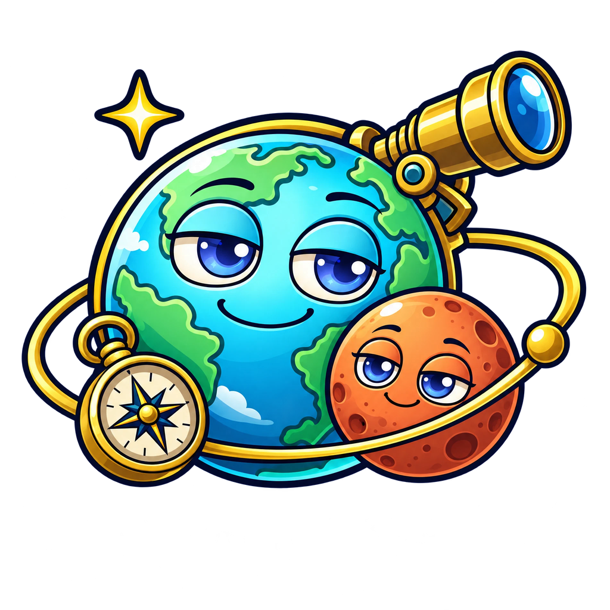
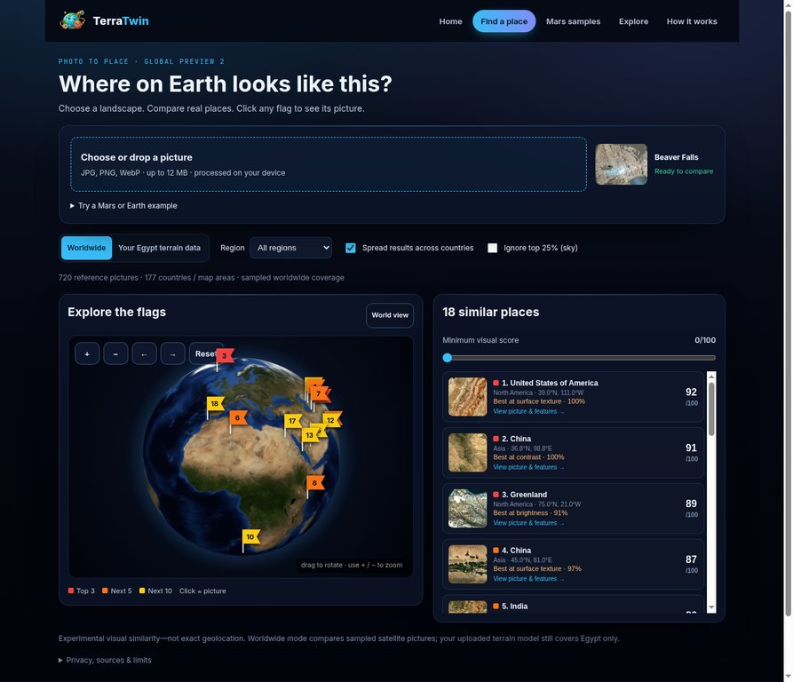
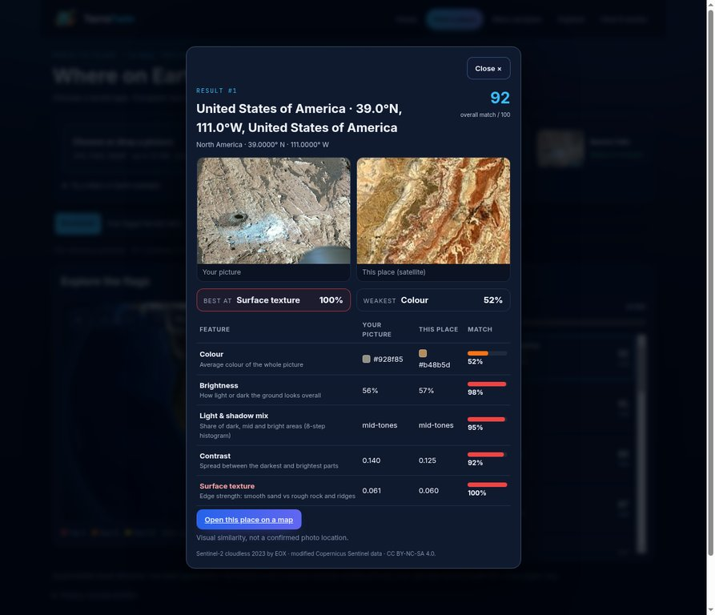

<p align="center">
  
</p>

<h1 align="center">TerraTwin</h1>

<p align="center">
  <b>Find Earth's twins of Mars and Moon landscapes.</b><br>
  Upload a picture and see the places on Earth that look most like it.
</p>

<p align="center">
  <a href="https://terratwin.manus.space">Live demo</a> ·
  <a href="docs/TerraTwin_Documentation.pdf">Documentation (PDF)</a> ·
  <a href="docs/PROJECT_SUMMARY.md">Project summary</a>
</p>

---

## About

Before rovers and astronauts go to the Moon or Mars, teams test their equipment at **analogue sites**: places on Earth that resemble the target location. Finding these sites usually takes expert knowledge and data spread across many sources.

TerraTwin finds Earth analogue sites for future Moon and Mars missions. It uses NASA Earthdata (SRTM, MODIS), the Planetary Data System (LRO LOLA and Diviner, Mars MOLA) and Copernicus to measure slope, roughness, temperature and aridity, then ranks Earth sites by similarity on an interactive map. Egypt's Western Desert is the case study.

<p align="center">
  
</p>

## Features

| | |
|---|---|
| **Photo finder** | Upload any landscape photo, or try one of the 9 real Mars rover sites |
| **Worldwide search** | Compares your photo with 720 satellite pictures from 177 countries and areas |
| **Coloured flags** | Red for the top 3 matches, orange for the next 5, yellow for the next 10 |
| **Side-by-side view** | Click a flag to see the real place next to your photo |
| **Feature breakdown** | Colour, brightness, light and shadow, contrast and texture, each with a match score |
| **Private** | Photos are analysed in your browser and never uploaded |

<p align="center">
  
</p>

## How it works

1. **Read the photo.** The browser turns the picture into 13 numbers that describe its colour, brightness, contrast and texture.
2. **Compare.** It compares those numbers with the same numbers for every satellite picture in the library.
3. **Show.** The closest places appear as flags on the 3D globe. Each flag explains which features matched.

## Results

| Model | What it does | Score |
|---|---|---|
| Landform classifier | Sorts terrain into escarpment, coarse fan, deltaic plain and hardpan flat | **99.6%** accuracy on unseen areas (baseline 50%) |
| Site-quality model | Rates how suitable a site is for rover testing | **R² 0.996**, Spearman 0.998 |
| Earth vs Mars check | Tests whether Earth and Mars terrain can be compared fairly | AUC 1.000 → **0.911** after calibration |

The models were trained on **9,680 terrain tiles**: 7,180 from Earth, 900 from Mars (Jezero Crater) and 1,600 from the Moon (south pole). See the [feature report](docs/FEATURE_REPORT.md) for how each photo feature performed.

## Project structure

```
TerraTwin/
├── website/    Web app (React, globe.gl, Chart.js)
├── ml/         Data pipeline, saved models and training scripts
├── backend/    Original FastAPI server (optional)
└── docs/       Summary, reports, data sources, PDF and images
```

## Quick start

**Website**
```bash
cd website
pnpm install
pnpm dev                              # open http://localhost:3000
python scripts/build_world_index.py   # downloads the 720 worldwide pictures (first run only)
```

**Machine learning**
```bash
cd ml
pip install -r requirements.txt
python 03_harmonize.py && python 04_ml_rank.py && python export_models.py
```

**Backend (optional)**
```bash
cd backend
pip install -r requirements.txt
uvicorn main:app --reload             # open http://localhost:8000/docs
```

## Data sources

- **Earth:** SRTM 30 m elevation, MODIS
- **Mars:** HRSC and MOLA elevation, and the Perseverance Initial Reports (Volumes 2 and 4)
- **Moon:** LRO LOLA and Diviner
- **Satellite pictures:** Sentinel-2 cloudless 2023 by EOX (contains modified Copernicus Sentinel data, CC BY-NC-SA 4.0)
- **Borders:** Natural Earth

All sources and licences are listed in [docs/DATA_SOURCES.md](docs/DATA_SOURCES.md).

## Limitations

- Scores measure **visual similarity**, not an exact location.
- Satellite pictures look down from above, while rover photos look sideways.
- Moon terrain comparisons are **not yet reliable**.

## Next steps

- Train a learned photo-to-place model on the labelled image dataset the team is collecting.
- Add more regions beyond Egypt's Western Desert.
